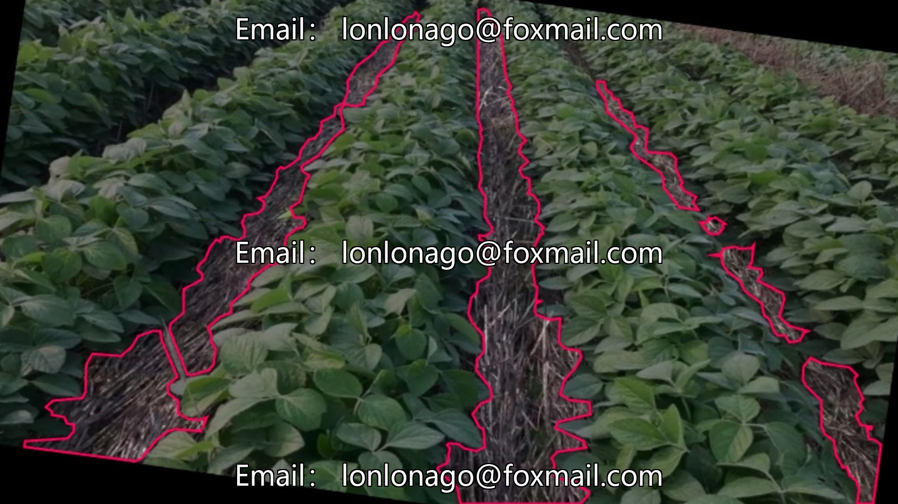
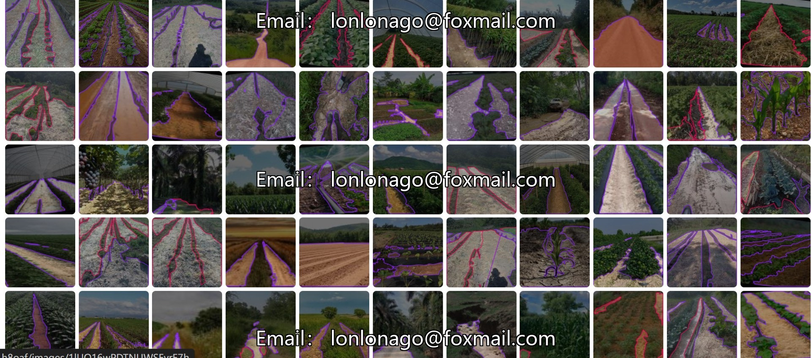
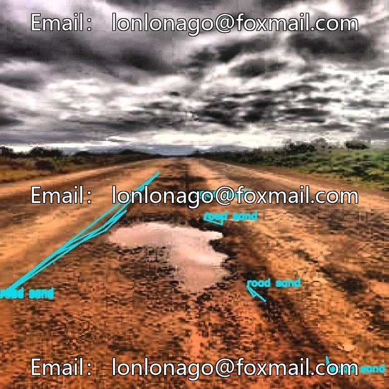
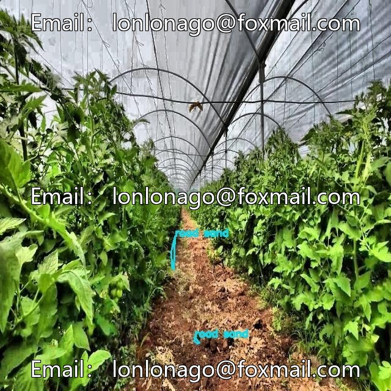
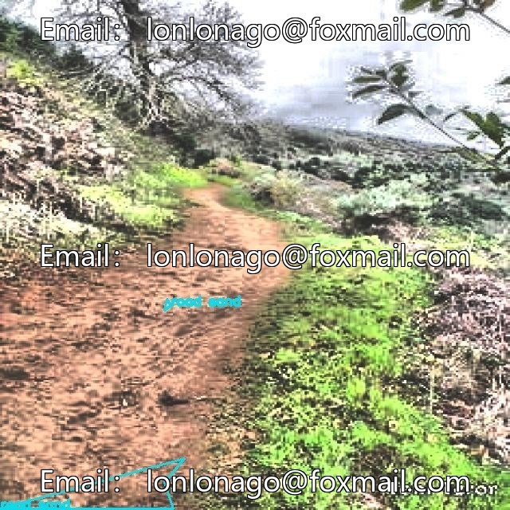
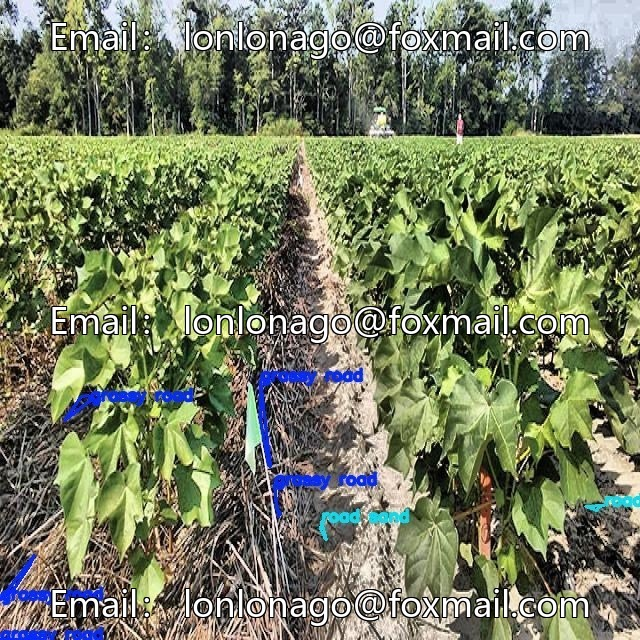
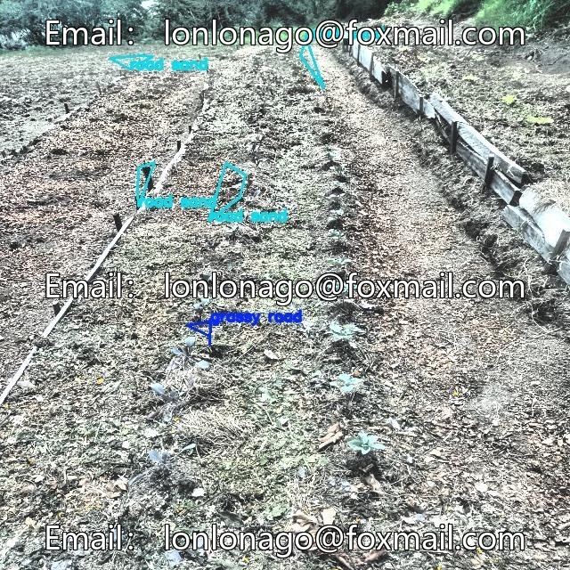

# Intelligent Agriculture Field Ramp Identification Dataset, Issue 10654, includes 500 field roads.

## Body

Intelligent Agriculture Field Ramp Identification Dataset, Issue 10654, comprising 500 labeled images of field roads, crops, and vegetable areas. Supports delivery in Yolo and VOC formats. Suitable for research on agricultural robot path planning, environmental perception, target detection, etc.

The dataset covers common scenarios such as soil roads, crop rows, and vegetable greenhouses, with strict annotation. The semantic boundaries of three categories (roads, crops, vegetables) are clear, compatible with mainstream detection frameworks, reducing the cost of data preprocessing, accelerating model training, and transfer learning.

Virtual materials, once sold, are non-refundable.
Interested friends, click "I want" to proceed.

## Images

## Payment

Here is a pay link on Stripe ( https://buy.stripe.com/3cs8yP7sY87d0vu9AB ). Please contact me lonlonago@foxmail.com after funding $89, and I will send you a complete data files , thank you!

